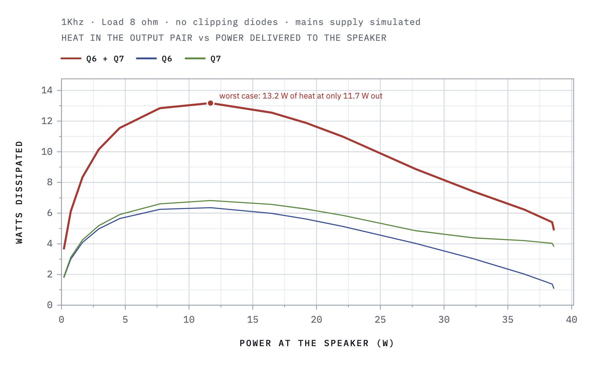
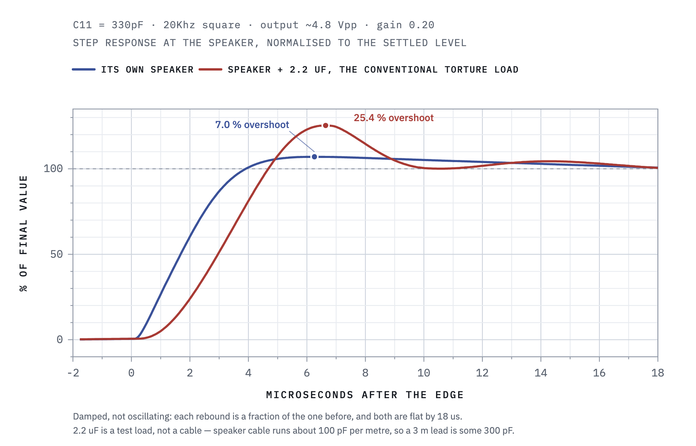

# Quasimod 40W — what the simulation says

Five things the bench cannot easily show, measured on the calibrated model:
where the heat goes, how much stability margin is left, how much noise and
hum the amplifier makes on its own, and what it sounds like with a guitar.

Everything here is reproducible from this repository. See
`tools/ltspice/README.md` for how, and `power_summary.md` for the headline
power figures.

---

## What the simulation finds

| quantity | simulated | conditions |
|---|---|---|
| max clean power | **25.2 W** (14.2 Vrms) | 1 kHz sine, 8 Ω, treble max, bass min, volume max, gain 0.20, clipping diodes out, below 1 % THD |
| max power at any setting | **38.5 W** (17.5 Vrms) | as above, 1.2 Vpp at the jack, 37 % THD |
| efficiency at full output | 75 % | as above, 1.8 Vpp at the jack |
| supply rail | 50.8 V idle → 45.0 V at full output | mains transformer calibrated against the bench: 51.2 V unloaded, 46.5 V loaded |
| worst-case heat, output pair | **13.2 W** (Q6 6.4 + Q7 6.8) | as above, 320 mVpp at the jack, only 11.7 W reaching the speaker |
| worst-case heat, emitter resistors | **1.0 / 1.6 W** (R16 / R17) | as above, at full output, not at the worst case for the transistors |
| step overshoot, own speaker | 7.0 % (≈ 62° phase margin) | 20 kHz square, 4.8 Vpp out, C11 = 330 pF, speaker impedance model |
| step overshoot, +2.2 µF | 25.4 % (≈ 43°) | as above, plus the conventional torture capacitor |
| oscillation on clipping | none found | 1 kHz sine driven hard into the rails, with and without 2.2 µF |
| noise at the speaker | 1154 µV (20 Hz–20 kHz) | volume max, tone flat, diodes out, 8 Ω |
| noise referred to input | 14.5 µV → **77 dB** S/N | against a pickup delivering 100 mVp |
| hum at the speaker | 0.48 mV idle → 6.78 mV at full power | mains chain simulated, 100 Hz component, −67 dB under the signal |

Everything above comes from the same calibrated model, driven from the
simulated mains transformer rather than an ideal rail, and with the transient
allowed 2 s to settle before anything is measured.

### Dissipation: what to watch

**The output transistors are not the problem.** 6.8 W worst case against a
70 W device is under 10 %. Working backwards from the catalogue figure, 70 W
at a 25 °C case with a 150 °C junction implies about 1.8 °C/W from junction to
case, so at worst case each device runs some 12 °C above its own case. With
both on one heatsink dissipating 13.2 W, a 2 °C/W sink puts the metal 26 °C
above ambient and the junctions near 65 °C in a 25 °C room. Comfortable — but
substitute your own heatsink's figure, because that term dominates all the
others.

**The emitter resistors are worth a second look.** R16 and R17 carry the
output current, so unlike the transistors their worst case *is* at full power:
1.04 W and 1.59 W. A 0.5 W part is not enough and a 1 W part is marginal; 2 W
or 3 W is the sane choice. Note also that they are not equal — R17 takes 50 %
more than R16, which is the quasi-complementary output stage being
asymmetric by construction, not a fault.

**One small-signal transistor runs warmer than you would guess.** Q10, a
BC556B in the preamp, sits at a third of its 500 mW. Nothing is wrong, but it
is the part with the least headroom relative to its rating in the whole
amplifier.

**Three limits of this analysis, stated plainly:**

1. **Every catalogue limit above is quoted with the case at 25 °C**, which is
   where no case in a working amplifier is. The real margin needs derating
   against the heatsink and the ambient temperature.
2. **LTspice does not simulate self-heating.** Every device here sits at
   27 °C no matter how much it dissipates; there is no junction temperature
   computed and no thermal feedback. The dissipation figures are therefore
   what a cold amplifier would do, and a hot one biases differently.
3. **Which matters here, because the bias diode is not on the heatsink.** D10
   sets the output stage's quiescent current and tracks the output
   transistors' temperature — except it cannot, because it is not bolted to
   the same piece of metal. The measured consequence is that the quiescent
   current falls from 40 mA cold to about 15 mA hot. That is a thermal effect
   the simulation structurally cannot show.

---

## 1. Power, and where the heat goes

1 kHz, 8 Ω, treble max, bass min, volume max, gain 0.20, clipping diodes out,
mains chain simulated.

| input | speaker | Q6 | Q7 | rest of the amp | from the mains | efficiency | rail | THD |
|-------|---------|----|----|------------------|-----------------|-----------|------|-----|
| 120 mVpp | 1.6 W | 4.1 W | 4.3 W | 1.4 W | 12.1 W | 14 % | 49.6 V | — |
| 320 mVpp | 11.7 W | 6.4 W | 6.8 W | 2.1 W | 28.8 W | 41 % | 47.3 V | — |
| 440 mVpp | 22.1 W | 5.1 W | 5.9 W | 2.7 W | 38.7 W | 57 % | 46.2 V | — |
| 800 mVpp | 36.3 W | 2.0 W | 4.2 W | 3.5 W | 50.4 W | 72 % | 45.1 V | 22 % |
| 1800 mVpp | 38.6 W | 1.1 W | 3.8 W | 3.6 W | 51.7 W | 75 % | 45.0 V | 51 % |

**The output transistors run hottest at a third of full power, not at full
power.** 13.2 W of heat when the speaker is only getting 11.7 W; at 38 W out,
less than 5 W. This is the textbook class-AB curve and it is worth knowing
before sizing a heatsink: the worst case for the heatsink is somebody playing
at a civilised volume, not somebody playing flat out.

Margin at that worst case, against the catalogue limit:

| part | dissipates | limit | uses |
|------|-----------|-------|------|
| Q6 | 6.35 W | 70 W | 9 % |
| Q7 | 6.82 W | 70 W | 10 % |
| Q4 / Q5 (drivers) | 0.22 / 0.14 W | 12.5 W | 2 % |
| Q10 | 0.165 W | 0.5 W | **33 %** |
| R16 / R17 (0.5 Ω emitter) | 0.36 / 0.38 W | — | — |

Every limit above is quoted with the case at 25 °C, which is where no case in
this amplifier is. The real margin needs derating against the heatsink. Even
so, the output pair is nowhere near trouble; the part working hardest relative
to its rating is **Q10**, a small-signal BC556B in the preamp at a third of its
500 mW.

### Power at the speaker

The headline numbers, measured against simulated:

| | measured | simulated |
|---|----------|-----------|
| max clean sine | 12.5 Vrms · 19.5 W | 14.2 Vrms · 25.2 W |
| max distorted sine | 17.4 Vrms · 37.8 W | 17.5 Vrms · 38.5 W |

Across the sweep it is the "speaker" column in the table above, and the X axis
of the figure.

One thing a resistive dummy load hides: how much actually arrives depends on
what you play. A real speaker's impedance rises at resonance, so the same
drive delivers less power at the bottom of the neck:

| | 82 Hz | 220 Hz | 440 Hz | 1 kHz | 2 kHz |
|---|------|--------|--------|-------|-------|
| into 8 Ω resistor | 0.49 W | 3.60 W | 13.2 W | 33.5 W | 37.6 W |
| into the real speaker | 0.20 W | 3.12 W | 13.3 W | 33.7 W | 36.6 W |

At the low E string the speaker receives **41 %** of what the dummy load
receives for the same setting. From 440 Hz up the two agree, so every power
figure quoted at 1 kHz is honest for most of what a guitar plays — but a low
open E is not delivering anything like the rated power.

### A correction to the clean power figure

`power_summary.md` used to give 20.9 W as the simulated maximum clean power.
**That number was measured before the waveform had settled** and it is too
low. With 2 s of settling the sub-1 % THD limit moves to 14.2 Vrms, 25.2 W.

So the model says the amplifier *should* deliver about 25 W clean, where the
bench delivers 19.5 W. Most of that gap is the output midpoint, and this is
worth following carefully because the obvious arithmetic gets it wrong.

The bench measures 23.6 V at `PRE_SPEAKER` against a 51.2 V rail; the model
sits at 25.7 V, essentially centred. A midpoint 2.1 V low clips one half-cycle
2.1 V early, so the naive sum says 4.2 Vpp of lost swing. **It is not 4.2.**
Forcing the model's midpoint to 23.6 V — by injecting 32.6 µA into Q1's base,
which shifts the DC operating point without touching any component value — and
re-measuring gives:

| midpoint | clean ceiling | power |
|----------|---------------|-------|
| 25.7 V, centred (model as drawn) | 40.1 Vpp · 14.2 Vrms | 25.2 W |
| 23.6 V, as the bench measures it | 37.3 Vpp · 13.3 Vrms | 22.1 W |
| the bench itself | 35.7 Vpp · 12.5 Vrms | 19.5 W |

The offset is worth **2.8 Vpp, not 4.2**, because the output stage does not
clip as a hard clamp at a fixed distance from each rail: shifting the bias
point moves the drive conditions too, and the loss is not one for one.

So the midpoint accounts for about **55 % of the gap** — 3.1 W of the 5.7 W —
and leaves 2.6 W unexplained. That remainder is a 6 % difference in output
voltage, which is roughly what you would expect from the things nobody
measured precisely: where exactly the gain pot was sitting, the scope's
amplitude accuracy, and the saturation voltages of the hand-built 2SD896
model, whose `RC` of 0.1 Ω and `RE` of 0.05 Ω are optimistic.

The useful conclusion survives intact: **a bias point 2 V off centre is
costing real clean power** — about 3 W, or an eighth of the total — and
centring it is the single cheapest improvement available to this amplifier.

And it is adjustable from the front of the board. RV1 sets the midpoint over a
very wide range — 35.4 V at one end of its travel, 4.5 V at the other, about
0.3 V per 1 % of rotation near the centre — so the 2 V that is missing is some
8 % of its travel. RV2 sets the quiescent current and does not move the
midpoint at all. The order matters, because RV1 drags the quiescent current
with it: set the midpoint with RV1 first, then the quiescent with RV2.

## 2. Stability

Square wave at 20 kHz with the compensation capacitor that is actually fitted,
output around 4.8 Vpp — deliberately far from clipping, because near the
ceiling saturation eats the overshoot and the amplifier looks better behaved
than it is.

This is the shape that matters. Into the load alone the edge barely
overshoots and there is nothing to settle. Add 2.2 µF and the output rises
more slowly, overshoots to 125 %, dips once, comes back
with a much smaller second bump around 14 µs and is flat by 18. One and a bit
cycles, each a fraction of the last: damped, not oscillating. That is what a
controlled response looks like, and it is what you want to see before trusting
an amplifier with an unknown cable.

**The load is the speaker model from the schematic, not a dead resistor** —
resonance, voice-coil inductance and all — with the dummy 8 Ω shown alongside
for comparison. It turns out to matter very little, and in the direction you
would not guess:

| load | overshoot |
|------|-----------|
| 8 Ω resistor | 7.1 % |
| real speaker | 7.0 % |
| 8 Ω + 2.2 µF | 23.2 % |
| real speaker + 2.2 µF | **25.4 %** |

On its own the speaker is indistinguishable from a resistor here, because at
these frequencies it is mildly inductive and an inductive load is *kinder* to
a feedback loop than a resistive one. Combined with cable capacitance it is
slightly worse, so the honest worst case is 25.4 %, not 23.2 %. The sweep
table below still uses the resistive load, which keeps it comparable with a
bench measurement made with a resistor and a capacitor.

**It does not oscillate on clipping either**, which is the failure a
small-signal step test cannot see. Driven hard into the rails, the plateau of
the clipped waveform should be a flat line; anything wobbling on it is
oscillation and cannot be confused with clipping harmonics. Over a 400 µs
plateau, with and without 2.2 µF, with the speaker model and with a resistor,
the residual has six zero crossings and a dominant frequency of 2–5 kHz — that
is the curvature of the rounded top, not ringing. Instability would appear at
100–200 kHz with hundreds of crossings.

**And 2.2 µF is a torture test, not a cable.** Speaker cable runs about
100 pF per metre, so a 3 m lead is some 300 pF — three orders of magnitude
below this, and the load sweep is flat until 200 nF. The number that describes
this amplifier driving its speaker is the 7 %, which is about 62° of phase
margin. The 25.4 % says what happens if someone does something strange, and
the answer is that it still settles.

A companion figure, `quasimod_stability_load.png`, sweeps the capacitive load
finely for four values of C11. Its summary:

| C11 | 8 Ω | + 2.2 µF | phase margin (8 Ω / 2.2 µF) | rise 10–90 % |
|------|------|-------|-------------|---------|
| 220p (schematic) | 8.7 % | 34.1 % | 60° / 36° | 2.35 µs |
| **330p (as built)** | **7.1 %** | **23.6 %** | **62° / 45°** | **2.79 µs** |
| 470p | 5.2 % | 15.5 % | 64° / 53° | 3.98 µs |
| 680p | 3.0 % | 9.3 % | 67° / 59° | 5.83 µs |

Phase margin here is the equivalent for a second-order system — approximate,
but it is the number people expect. C11 is the Miller compensation around the
voltage amplifier stage, and a capacitive load is what a long speaker cable
looks like.

**The capacitor I happened to have was a better choice than the one on the
schematic.** The board ended up with 330p instead of 220p because that is what
was in the drawer, and that accident bought 9° of phase margin into a
capacitive load for half a microsecond of rise time — which at guitar
frequencies is free. At 220p the model rings at 153 kHz into 2.2 µF, matching
a ringing measured on this amplifier earlier at 145 kHz. It stays at 330p.

The model knows nothing about wiring inductance or board parasitics, which is
where VHF oscillation usually comes from. This is the compensation pole, not
the layout.

---

## 3. Noise

Small-signal noise analysis, 20 Hz to 20 kHz, 8 Ω load, clipping diodes out,
tone controls flat.

| Volume | at the speaker | gain | referred to input | S/N vs 100 mVp pickup |
|--------|----------------|------|-------------------|------------------------|
| max | 1154 µV | 79.9 | 14.5 µV | 77 dB |
| 0.5 | 120 µV | 8.1 | 14.8 µV | 77 dB |
| 0.25 | 23 µV | 0.8 | 28.5 µV | 71 dB |

Input-referred noise barely moves with the volume control, which is the
expected answer and a good check on the method: the noise is made before the
volume pot, so turning it down scales signal and noise together.

**One transistor makes 88 % of it.**

| part | contribution | share |
|------|--------------|-------|
| Q12 | 1085 µV | 88.4 % |
| R57 (120 k bias) | 257 µV | 5.0 % |
| R60, R61 (250 k) | 177 µV each | 4.6 % |
| R58, R62 | ~100 µV | 1.5 % |

Q12 is the first transistor the guitar meets, and almost all of its
contribution is base-current shot noise rather than thermal noise. That points
at the base current: shot noise is a current, and it develops a voltage across
whatever impedance the source presents — and the source here is a pickup with
2.2 H of inductance, which is 138 kΩ at 10 kHz. Hence the one actionable
result of this whole section: **a higher-beta device in that socket, same
collector current, should measurably lower the hiss.** A BC550C or BC547C in
place of the BC546B is a 30-cent experiment that the model says will work.

Where the noise lives, by band:

| 20–200 Hz | 200 Hz–2 kHz | 2–20 kHz |
|-----------|--------------|----------|
| 8.5 µV | 122 µV | 1145 µV |

98 % of the noise power is above 2 kHz, peaking around 4.8 kHz where the
amplifier's own response peaks. Two consequences. First, the missing 1/f noise
in these transistor models — none of them carry `KF`/`AF` — does not matter
here, because 1/f lives below 1 kHz where there is almost nothing to add to.
Second, the guitar cabinet is 19 dB down at 8 kHz, so the audible hiss is
considerably less than the figure at the speaker terminals suggests.

---

## 4. Hum

Hum is not noise and does not get measured the same way: it is the reservoir
ripple finding its way into the signal path, deterministic rather than random,
and the noise analysis cannot see it at all. Mains chain simulated, read as
the Fourier components at the speaker, referred to the maximum clean output
(12.5 Vrms, 17.7 V peak).

| condition | 100 Hz | 200 Hz | total | referred to full output |
|-----------|--------|--------|-------|-------------------------|
| idle, volume at maximum | 0.51 mV | 0.09 mV | 0.52 mV | **−91 dB** |
| full output | 4.30 mV | 0.55 mV | 4.34 mV | **−72 dB** |

Converged: repeating with 3.5 s of settling instead of 2 s moves the 100 Hz
figures by 0.6 % at idle and 0.05 % at full output.

**It is all at 100 Hz.** A full-wave bridge charges the reservoir twice per
mains cycle, so the ripple fundamental is twice the mains frequency. The
simulated 50 Hz component is 0.03 mV at 2 s of settling and 0.003 mV at 3.5 s
— it is converging on zero, and that is the correct answer rather than a
small measurement: **this model has no mechanism that could produce 50 Hz at
all.** The bridge is symmetric, the diodes identical, and nothing in a SPICE
netlist couples a transformer magnetically into signal wiring. So the 50 Hz
column here is a settling diagnostic, not a result. On the bench it would be a
genuine and useful check — a 50 Hz term there means half-wave rectification, a
failed bridge diode, or stray coupling from the transformer — but that check
cannot be made in simulation, and quoting a simulated 50 Hz figure as evidence
of a healthy supply would be circular.

**It climbs 18 dB between silence and full output**, which is the only part of
this that is worth remembering. The ripple grows with the current drawn from
the reservoir: between charging pulses the amplifier is draining it harder, so
the sawtooth on the rail gets deeper. The same sag that costs 5 V of headroom
at full output is what makes the hum audible. Measuring hum at idle — which is
the easy measurement, and the one most people make — tells you almost nothing
about the condition that matters.

At −72 dB under full output, with no regulation anywhere in the supply, this
is a perfectly respectable result for a single-rail amplifier.

*A caution for anyone reproducing this: these numbers need 2 s of settling.
At 0.9 s the output coupling capacitor is still charging, and the Fourier
analysis books that slow drift as a 50 Hz component — 1.3 mV of it, larger
than the real 100 Hz ripple, which is impossible in a full-wave supply and was
the clue that something was wrong.*

---

## 5. What it sounds like

A real guitar DI played through the simulated amplifier, sample by sample —
the diode clipper, the power stage, the supply sag and the 100 Hz hum are the
circuit's own, not a model bolted on afterwards. The only thing done outside
LTspice is the convolution with a cabinet impulse response, because that part
is acoustic rather than electrical. Cabinet: Fender Deluxe Reverb 1×12.

Conditions match the THD curve exactly — bass 0.5, treble 0.5, volume 0.5 —
and the input is scaled so the guitar peaks at 750 mV, which is the 1.5 Vpp a
moderately hard pick gives on this amplifier. All six files are normalised by
the **same** factor, so the loudness differences between them are real.

| file | gain | diodes | peak at the speaker | how I described it by ear |
|------|------|--------|---------------------|---------------------|
| `clean_g20.wav` | 0.20 | none | 5.5 V | clean, warm, pleasant |
| `clean_g50.wav` | 0.50 | none | 9.6 V | still clean on 2.3 Vpp peaks |
| `u1_g50.wav` | 0.50 | U1 (1.3 V) | 7.2 V | one side: almost like no diodes |
| `u2_g50.wav` | 0.50 | U2 (0.63 V) | 8.6 V | — |
| `both_g50.wav` | 0.50 | both | 2.4 V | both: much more distorted, quieter |
| `clean_g100.wav` | 1.00 | none | 22.9 V | distorted, overdrive-like |
| `both_g100.wav` | 1.00 | both | 2.9 V | strong overdrive, not fuzz |

Each file is the full 20 s take, not an excerpt. That matters more than it
sounds: the first renders used only the opening six seconds, which never got
loud enough for the clipper to do much, and on that excerpt `u1_g50` peaked
slightly *higher* than the clean setting. Over the whole take, which has
harder passages in it, the ordering reverses and the clipper shows itself.

Plus `ref_dry_cab.wav`: the dry guitar through the cabinet alone, as a
reference for what the amplifier is actually doing.

**The model reproduces the "quieter" part of the impression.** Switching both
clipper branches in at the same gain drops the peak from 9.6 V to 2.4 V — a
factor of four, or 12 dB. At full gain it is starker still: 22.9 V against
2.9 V, nearly 18 dB. That is not a side effect to be corrected; it is what a
diode clipper does, and it is what I wrote down when I played it: *much more
distorted, and quieter*.

**Do not read the two single-diode files by their peaks.** U1 clips the
positive branch and U2 the negative one, so each leaves the other half-cycle
intact, and the absolute peak just reports whichever side survived. RMS is the
comparable number: 0.46 V clean, 0.45 V with U1, 0.43 V with U2, 0.29 V with
both. That ordering matches the THD curve, where U2 — the 0.63 V branch —
distorts more than U1 at the same gain, as its lower threshold implies.

Worth noting where `clean_g100` sits: its 22.9 V peaks are within a volt of
the output stage's 23 V ceiling, so on the loudest notes the distortion in
that file is the power stage clipping, not the preamp. The same at full gain is even starker: 15.5 V
against 2.7 V.
